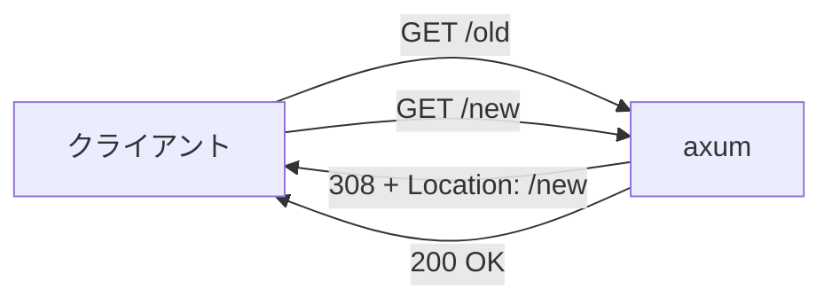

## TL;DR

- axum 0.7 の `Redirect::permanent()` は **308 Permanent Redirect** を返す。`Redirect::to()` は 303、`Redirect::temporary()` は 307 なので混同しやすい
- 301 と 308 の違いは **メソッドとボディが保持されるか**。API や POST を含むパスの恒久移転は 308 が安全
- 本記事では次の 5 パターンを、コピペで動く最小コードで示す
  1. 固定パスの恒久リダイレクト
  2. パスパラメータを引き継ぐリダイレクト
  3. `www.` → apex ドメインの正規化 (クエリ保持)
  4. 末尾スラッシュの正規化
  5. `tower::ServiceExt::oneshot` によるテスト
- 対象は axum 0.7 系 (記事執筆時点)。0.8 ではパス記法が変わるので注意点を後述する

## 想定読者と前提

- Rust の async と axum の基本 (`Router` / ハンドラ / `extractor`) を理解している
- Nginx や CDN の設定ではなく、**アプリケーション層で** リダイレクトを制御したい

使用クレートとライセンスは次のとおり。いずれも公式リポジトリ・crates.io で確認できる。

| クレート | 用途 | ライセンス |
|---|---|---|
| axum | Web フレームワーク | MIT |
| tokio | 非同期ランタイム | MIT |
| tower | `ServiceExt::oneshot` (テスト用) | MIT |

```toml
[dependencies]
axum = "0.7"
tokio = { version = "1", features = ["full"] }

[dev-dependencies]
tower = { version = "0.5", features = ["util"] }
```

## 1. まず押さえる: リダイレクトのステータスコード早見表

| コード | 意味 | 恒久/一時 | メソッド保持 | axum の API |
|---|---|---|---|---|
| 301 | Moved Permanently | 恒久 | 保証なし (POST→GET に変わることがある) | 標準 API なし (自前でレスポンス構築) |
| 302 | Found | 一時 | 保証なし | 標準 API なし |
| 303 | See Other | 一時 | GET に変更 | `Redirect::to()` |
| 307 | Temporary Redirect | 一時 | **保持** | `Redirect::temporary()` |
| 308 | Permanent Redirect | 恒久 | **保持** | `Redirect::permanent()` |

(RFC 9110 §15.4 を参照)

ここで注意したいのは `Redirect::to()` が **303** を返す点。名前から恒久的リダイレクトを連想して使うと、意図せず一時扱いになる。フォーム送信後の PRG (Post/Redirect/Get) には `to()` が向いているが、URL 移転には向かない。



### 301 ではなく 308 を選ぶ理由

301 は歴史的経緯で、一部クライアントが POST を GET に書き換えて再送する実装になっている。ブラウザでの閲覧ページなら問題になりにくい。一方、Webhook 受信や API エンドポイントの移転で 301 を使うと、ボディが消えたり、メソッドが変わったりして原因調査に時間を取られる。

308 なら **メソッドもボディも維持したまま** 新 URL へ再送される。SEO 上も恒久移転のシグナルとして扱われ、検索エンジンは 301 と同様に評価を引き継ぐ。Google Search Central のドキュメントでも 301 / 308 は恒久リダイレクトとして扱われている。

実装コストは同じなので、迷ったら 308 でよい。

## 2. パターン 1: 固定パスの恒久リダイレクト

最小構成は次のとおり。

```rust
use axum::{response::Redirect, routing::get, Router};

#[tokio::main]
async fn main() {
    let app = Router::new()
        .route("/old-blog", get(|| async { Redirect::permanent("/blog") }))
        .route("/blog", get(|| async { "blog index" }));

    let listener = tokio::net::TcpListener::bind("0.0.0.0:3000").await.unwrap();
    axum::serve(listener, app).await.unwrap();
}
```

ポイントは 3 つある。

- クロージャが `Redirect` を返すだけで、`IntoResponse` が実装済みなのでそのまま動く
- `Location` ヘッダは引数の文字列がそのまま入る (相対パスも可)
- `get` だけを登録しているため、`/old-blog` への POST は 405 になる。POST も 308 で転送したい場合は `any(...)` を使う

```rust
use axum::routing::any;

Router::new().route("/old-api", any(|| async { Redirect::permanent("/api/v2") }));
```

## 3. パターン 2: パスパラメータを引き継ぐ

`/posts/123` を `/articles/123` に移転する例。

```rust
use axum::{extract::Path, response::Redirect, routing::get, Router};

async fn legacy_post(Path(id): Path<u64>) -> Redirect {
    Redirect::permanent(&format!("/articles/{id}"))
}

fn app() -> Router {
    Router::new()
        .route("/posts/:id", get(legacy_post))
        .route("/articles/:id", get(|Path(id): Path<u64>| async move { format!("article {id}") }))
}
```

`Path<u64>` で型を絞っているので、`/posts/abc` のような入力は extractor の段階で 400 になる。これにより **オープンリダイレクト** (ユーザー入力を無検証で `Location` に埋め込む脆弱性) を避けやすい。

ユーザー入力から `Location` を組み立てる場合は、次の方針を守る。

- 数値や enum に型変換できるものだけを埋め込む
- 任意の文字列を受け取る場合は許可リスト (allowlist) と照合する
- `//evil.example` のようなスキーム相対 URL を弾く

## 4. パターン 3: `www.` → apex ドメインの正規化 (クエリ保持)

ドメイン正規化はミドルウェアとして実装すると、ルート定義と分離できて扱いやすい。

```rust
use axum::{
    extract::Request,
    http::header,
    middleware::{self, Next},
    response::{IntoResponse, Redirect, Response},
    routing::get,
    Router,
};

async fn canonical_host(req: Request, next: Next) -> Response {
    let host = req
        .headers()
        .get(header::HOST)
        .and_then(|v| v.to_str().ok())
        .unwrap_or("");

    // ポート番号を除いてから判定する
    let host_no_port = host.split(':').next().unwrap_or(host);

    if let Some(apex) = host_no_port.strip_prefix("www.") {
        let pq = req
            .uri()
            .path_and_query()
            .map(|p| p.as_str())
            .unwrap_or("/");
        let target = format!("https://{apex}{pq}");
        return Redirect::permanent(&target).into_response();
    }

    next.run(req).await
}

pub fn app() -> Router {
    Router::new()
        .route("/", get(|| async { "home" }))
        .route("/docs", get(|| async { "docs" }))
        .layer(middleware::from_fn(canonical_host))
}
```

### ハマりどころ

1. **クエリ文字列を落とさない**: `uri().path()` だけを使うと `?page=2` が消える。`path_and_query()` を使えば、パスとクエリをまとめて引き継げる
2. **スキームの決め打ち**: 例では `https` を固定している。リバースプロキシ配下で HTTP/HTTPS が混在する場合は、`X-Forwarded-Proto` を信頼できるプロキシからのみ読む設計にする
3. **`Host` ヘッダは信頼しすぎない**: 今回は `www.` で始まる場合のみ処理し、それ以外は素通しにしている。任意の `Host` を `Location` に反映させるとオープンリダイレクトになりうる
4. **ミドルウェアの適用範囲**: `Router::layer` が未マッチパス (fallback) にも効くかどうかはバージョンで挙動が変わった経緯がある。後述のテストで未マッチパスも確認しておくと安全

## 5. パターン 4: 末尾スラッシュの正規化

`/docs/` と `/docs` が両方 200 を返すと、検索エンジンに重複コンテンツと見なされることがある。`/docs/` を `/docs` に 308 で寄せる例を示す。

`Router::layer` の適用範囲に依存しないよう、**fallback ハンドラで処理する** 方式にした。

```rust
use axum::{
    http::{StatusCode, Uri},
    response::{IntoResponse, Redirect, Response},
    routing::get,
    Router,
};

async fn fallback(uri: Uri) -> Response {
    let path = uri.path();

    if path.len() > 1 && path.ends_with('/') {
        let trimmed = path.trim_end_matches('/');
        let trimmed = if trimmed.is_empty() { "/" } else { trimmed };
        let target = match uri.query() {
            Some(q) => format!("{trimmed}?{q}"),
            None => trimmed.to_string(),
        };
        return Redirect::permanent(&target).into_response();
    }

    StatusCode::NOT_FOUND.into_response()
}

pub fn app_with_slash_policy() -> Router {
    Router::new()
        .route("/docs", get(|| async { "docs" }))
        .fallback(fallback)
}
```

動作は次のようになる。

| リクエスト | 結果 |
|---|---|
| `GET /docs` | 200 |
| `GET /docs/` | 308 → `/docs` |
| `GET /docs/?page=2` | 308 → `/docs?page=2` |
| `GET /unknown` | 404 |
| `GET /unknown/` | 308 → `/unknown` → 404 |

最後の行のように、存在しないパスでも一度リダイレクトされてから 404 になる。気になる場合は、ルート表と照合してからリダイレクトする実装に拡張する。

なお、`tower-http` の `NormalizePathLayer` は **リダイレクトではなく内部で URI を書き換える** ため、外部から見ると `/docs/` も 200 になる。SEO 目的で URL を一本化したい場合は、リダイレクト方式の方が目的に合う。

## 6. パターン 5: `oneshot` でリダイレクトをテストする

リダイレクトは、ステータスコードと `Location` を単体テストで固定しておくと回帰を防ぎやすい。サーバーを起動せず、`Router` に直接リクエストを流せる。

```rust
#[cfg(test)]
mod tests {
    use super::*;
    use axum::{
        body::Body,
        http::{header, Request, StatusCode},
    };
    use tower::ServiceExt; // oneshot

    async fn get_with_host(app: Router, uri: &str, host: &str) -> axum::response::Response {
        app.oneshot(
            Request::builder()
                .uri(uri)
                .header(header::HOST, host)
                .body(Body::empty())
                .unwrap(),
        )
        .await
        .unwrap()
    }

    #[tokio::test]
    async fn www_is_redirected_with_query() {
        let res = get_with_host(app(), "/docs?page=2", "www.example.com").await;
        assert_eq!(res.status(), StatusCode::PERMANENT_REDIRECT);
        assert_eq!(
            res.headers()[header::LOCATION],
            "https://example.com/docs?page=2"
        );
    }

    #[tokio::test]
    async fn apex_is_served_as_is() {
        let res = get_with_host(app(), "/docs", "example.com").await;
        assert_eq!(res.status(), StatusCode::OK);
    }

    #[tokio::test]
    async fn trailing_slash_is_redirected() {
        let res = get_with_host(app_with_slash_policy(), "/docs/?a=1", "example.com").await;
        assert_eq!(res.status(), StatusCode::PERMANENT_REDIRECT);
        assert_eq!(res.headers()[header::LOCATION], "/docs?a=1");
    }

    #[tokio::test]
    async fn unmatched_path_on_www_is_also_redirected() {
        // layer が fallback にも効くか確認する回帰テスト
        let res = get_with_host(app(), "/not-found", "www.example.com").await;
        assert_eq!(res.status(), StatusCode::PERMANENT_REDIRECT);
    }
}
```

実行は `cargo test` だけで済む。テスト名を挙動の説明にしておくと、後からリダイレクト仕様を読み返す際にそのまま仕様書として使える。

## 7. 本番投入前のチェックリスト

- **ブラウザの 308 キャッシュ**: 恒久リダイレクトはブラウザに長期間キャッシュされることがある。誤った `Location` を一度配信すると、サーバー側を直してもクライアントに残る。開発中は `Redirect::temporary()` (307) で動作確認し、確定後に `permanent()` へ切り替えるのが安全
- **リダイレクトチェーンを作らない**: `http://www.example.com/docs/` が複数ホップで最終 URL に届くと、クロール効率も体感速度も落ちる。可能なら 1 ホップで最終 URL に飛ばす
- **`curl -I` で実機確認**: `curl -sI -H 'Host: www.example.com' http://localhost:3000/docs?page=2` で `HTTP/1.1 308 Permanent Redirect` と `location:` ヘッダを確認できる
- **HEAD / OPTIONS の扱い**: `get()` だけを登録したルートでは HEAD は処理されるが、OPTIONS (CORS プリフライト) は別途考慮が必要。プリフライトにはリダイレクトを返さない方が無難 (多くのブラウザはプリフライトのリダイレクトを許可しない)

## 8. axum 0.8 への移行メモ

axum 0.8 では、パスパラメータの記法が `/:id` から `/{id}` に変わった。パターン 2 のルート定義は次のように書き換える。

```rust
// 0.7
.route("/posts/:id", get(legacy_post))
// 0.8
.route("/posts/{id}", get(legacy_post))
```

`Redirect` 自体の API (`to` / `temporary` / `permanent`) は同様に使えるが、アップグレード時は公式の CHANGELOG とマイグレーションガイドを確認してほしい。

## まとめ

- axum の `Redirect::permanent
