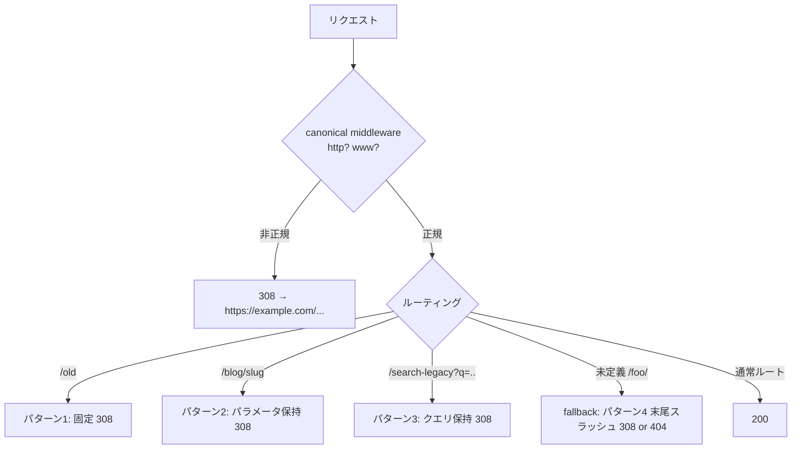

## TL;DR

- axum の `Redirect::permanent` が返すのは **301 ではなく 308**。メソッドとボディが保持される
- 実務で出てくるリダイレクトは 5 パターンに整理できる。固定パス、パスパラメータ保持、クエリ保持、末尾スラッシュ正規化、HTTPS/www 正規化の 5 つ
- ユーザー入力を `Location` に入れる実装には、**panic** と **オープンリダイレクト** の 2 つの落とし穴がある
- すべて `tower::ServiceExt::oneshot` でサーバーを起動せずにテストできる

動作確認の前提は次のとおり。

| クレート | バージョン | ライセンス |
|---|---|---|
| axum | 0.8 系 | MIT |
| tokio | 1.x | MIT |
| tower | 0.5 系 | MIT |

axum 0.7 以前では、パスパラメータの記法が `/:slug` です。0.8 以降は `/{slug}` になっています。本記事のコードは 0.8 記法で書いています。

## 1. なぜ 301 ではなく 308 なのか

リダイレクト系のステータスコードは、次の 2 軸で整理できます。

| コード | 永続性 | メソッド保持 | axum の API |
|---|---|---|---|
| 301 Moved Permanently | 永続 | 保持されない場合がある(歴史的経緯で POST→GET 化) | 標準 API なし |
| 302 Found | 一時 | 保持されない場合がある | 標準 API なし |
| 303 See Other | 一時 | GET に変更 | `Redirect::to` |
| 307 Temporary Redirect | 一時 | **保持** | `Redirect::temporary` |
| 308 Permanent Redirect | 永続 | **保持** | `Redirect::permanent` |

301 は仕様策定当時の実装の都合で、多くのクライアントが POST を GET に書き換えてきました。そのため、API エンドポイントの移設で 301 を使うと、リクエストボディが消えて事故になります。308 は RFC 7538 で追加されたコードで、**「永続移動かつメソッド変更禁止」** が明文化されています(現行は RFC 9110 に統合)。

SEO 面では、Google は 301 と 308 を同等の永続リダイレクトとして扱うと説明しています。新規実装では 308 を選ぶのが無難です。

なお axum には、`Redirect::permanent` が 301 を返すと誤解されやすい命名上の落とし穴があります。実際は 308 です。

## 2. 全体像

今回作る構成は次のとおりです。



先にプロジェクトを用意します。

```toml
# Cargo.toml
[package]
name = "redirect-demo"
version = "0.1.0"
edition = "2021"

[dependencies]
axum = "0.8"
tokio = { version = "1", features = ["full"] }

[dev-dependencies]
tower = { version = "0.5", features = ["util"] }
```

## 3. パターン 1: 固定パスの 308

最も単純なケースです。旧 URL から新 URL へ一対一で移します。

```rust
use axum::{response::Redirect, routing::get, Router};

async fn old_about() -> Redirect {
    Redirect::permanent("/about")
}

fn app() -> Router {
    Router::new()
        .route("/about", get(|| async { "about page" }))
        .route("/company", get(old_about))
}
```

`Redirect` は `IntoResponse` を実装しているので、ハンドラの戻り値にそのまま書けます。

`get` だけを登録すると、POST は 405 になります。API の旧エンドポイントを移設するなら、`any` や `post` も登録してください。308 ならボディも新 URL に再送されます。

```rust
use axum::routing::any;

Router::new().route("/api/v1/items", any(|| async {
    Redirect::permanent("/api/v2/items")
}))
```

## 4. パターン 2: パスパラメータを保持して 308

ブログ URL の構造を変えるケースです。`/blog/{slug}` を `/articles/{slug}` に移します。

```rust
use axum::{extract::Path, response::{IntoResponse, Redirect, Response}, http::StatusCode};

async fn blog_to_articles(Path(slug): Path<String>) -> Response {
    // 後述: 入力検証を必ず通す
    if !is_safe_slug(&slug) {
        return StatusCode::NOT_FOUND.into_response();
    }
    Redirect::permanent(&format!("/articles/{slug}")).into_response()
}

fn is_safe_slug(s: &str) -> bool {
    !s.is_empty()
        && s.len() <= 128
        && s.bytes().all(|b| b.is_ascii_alphanumeric() || b == b'-' || b == b'_')
}
```

### 落とし穴 A: `Redirect::permanent` は不正な値で panic する

axum の `Redirect` は内部で `Location` ヘッダ値を生成します。このとき、**ヘッダ値として不正な文字列を渡すと panic します**(docs.rs の `Redirect` のドキュメントに、不正な URI で panic する旨の記載があります)。

`Path<String>` は **パーセントデコード済み** の値を返します。そのため、攻撃者が `%0d%0a` のような制御文字を含む URL を送ると、デコード後の文字列が `Location` に入り、panic や想定外の挙動につながります。

対策は次の 2 つです。

1. 受け取った値を **ホワイトリスト** で検証する(上記 `is_safe_slug`)
2. 日本語スラッグなどを許容したい場合は、再度パーセントエンコードしてから埋め込む

ユーザー入力を `Location` に入れる箇所は、すべて検証を挟むと決めておくと安全です。

## 5. パターン 3: クエリ文字列を保持して 308

`/search-legacy?q=rust&page=2` を `/search?q=rust&page=2` に移す場合、クエリを落とすとユーザーの検索結果が失われます。`Uri` エクストラクタで生のクエリを取り出します。

```rust
use axum::http::Uri;

async fn search_legacy(uri: Uri) -> Redirect {
    let target = match uri.query() {
        Some(q) => format!("/search?{q}"),
        None => "/search".to_string(),
    };
    Redirect::permanent(&target)
}
```

`uri.query()` は **エンコードされたままの文字列** を返します。`Query<HashMap<..>>` でパースして再シリアライズすると、順序や重複キーが変わることがあります。単純な付け替えなら、生のまま渡すほうが安全です。

## 6. パターン 4: 末尾スラッシュ正規化(fallback で実装)

`/about` と `/about/` が両方 200 を返すと、検索エンジンからは重複コンテンツと見なされる可能性があります。方針は「末尾スラッシュなしを正規とし、ありは 308 でなしへ寄せる」です。

tower-http に `NormalizePath` がありますが、これは **内部で URI を書き換えるだけで、リダイレクトはしません**。リダイレクトさせたい場合は自前で実装します。

素直なのは `fallback` を使う方法です。ルートに一致しなかったリクエストだけがここに来ます。

```rust
use axum::{extract::OriginalUri, http::StatusCode, response::{IntoResponse, Response}};

async fn fallback(OriginalUri(uri): OriginalUri) -> Response {
    let path = uri.path();

    if path.len() > 1 && path.ends_with('/') {
        let trimmed = path.trim_end_matches('/');

        // 落とし穴 B: "//evil.example/" → "//evil.example" はオープンリダイレクトになる
        if trimmed.starts_with('/') && !trimmed.starts_with("//") && !trimmed.is_empty() {
            let target = match uri.query() {
                Some(q) => format!("{trimmed}?{q}"),
                None => trimmed.to_string(),
            };
            return Redirect::permanent(&target).into_response();
        }
    }

    StatusCode::NOT_FOUND.into_response()
}
```

### 落とし穴 B: プロトコル相対 URL によるオープンリダイレクト

`Location: //evil.example` は、ブラウザから見ると「現在のスキームで `evil.example` へ」という意味です。`//evil.example/` にアクセスされたとき、素朴に末尾スラッシュを削ると、このような `Location` を返してしまいます。

上記コードでは `starts_with("//")` を弾いています。「リダイレクト先は必ず単一の `/` で始まるパス」というルールを、コードに明示しておくと安全です。

ルーターへの組み込みは次のとおりです。

```rust
fn app() -> Router {
    Router::new()
        .route("/about", get(|| async { "about page" }))
        .route("/company", get(old_about))
        .route("/blog/{slug}", get(blog_to_articles))
        .route("/search-legacy", get(search_legacy))
        .fallback(fallback)
}
```

## 7. パターン 5: HTTPS / www の正規化 middleware

リバースプロキシや CDN の裏でアプリを動かす場合、アプリ側で `http://www.example.com/...` を `https://example.com/...` へ寄せたいことがあります。`axum::middleware::from_fn` で実装します。

```rust
use axum::{
    extract::Request,
    http::header,
    middleware::Next,
    response::{IntoResponse, Redirect, Response},
};

const CANONICAL_HOST: &str = "example.com";
const WWW_HOST: &str = "www.example.com";

async fn canonicalize(req: Request, next: Next) -> Response {
    let headers = req.headers();

    let host = headers
        .get(header::HOST)
        .and_then(|v| v.to_str().ok())
        .unwrap_or("");

    // プロキシが付与する X-Forwarded-Proto を参照(直接公開の場合は別途 TLS 終端の判定が必要)
    let proto = headers
        .get("x-forwarded-proto")
        .and_then(|v| v.to_str().ok())
        .unwrap_or("https");

    let needs_https = proto == "http";
    let needs_apex = host == WWW_HOST;

    if needs_https || needs_apex {
        let pq = req
            .uri()
            .path_and_query()
            .map(|p| p.as_str())
            .unwrap_or("/");
        let location = format!("https://{CANONICAL_HOST}{pq}");
        return Redirect::permanent(&location).into_response();
    }

    next.run(req).await
}
```

組み込みは `.layer(middleware::from_fn(canonicalize))` です。

```rust
use axum::middleware;

fn app() -> Router {
    Router::new()
        .route("/about", get(|| async { "about page" }))
        // ...前述のルート...
        .fallback(fallback)
        .layer(middleware::from_fn(canonicalize))
}
```

設計上のポイントは 3 つあります。

1. **`Host` ヘッダを使ってリダイレクト先を組み立てない**。`Host` は攻撃者が自由に設定できます。`Location` のホスト部は定数 (`CANONICAL_HOST`) に固定し、`Host` は「正規ホストと一致するか」の判定にだけ使います
2. **`X-Forwarded-Proto` を信用してよいのは、信頼できるプロキシの背後だけ**。アプリが直接インターネットに露出している構成では、ヘッダを偽装されます。プロキシ側で上書きする設定が前提です
3. **ヘルスチェックなどプロキシ内部からの http アクセスは除外する**。除外しないと、ロードバランサのヘルスチェックが 308 を受け取って失敗します。パスで分岐するか、ヘルスチェック用ルートを `canonicalize` の外に置いてください

また `layer` の適用範囲は axum のバージョンで細部が変わりえます。fallback にも middleware が効いていることを、後述のテストで確認しておくと安心です。

## 8. テスト: サーバーを起動せずに検証する

`tower::ServiceExt::oneshot` を使えば、`Router` に直接リクエストを流して、ステータスと `Location` を検証できます。

```rust
#[cfg(test)]
mod tests {
    use super::*;
    use axum::{
        body::Body,
        http::{header, Request, StatusCode},
    };
    use tower::ServiceExt;

    async fn get_res(uri: &str, extra: &[(&str, &str)]) -> axum::response::Response {
        let mut b = Request::builder().uri(uri);
        for (k, v) in extra {
            b = b.header(*k, *v);
        }
        app().oneshot(b.body(Body::empty()).unwrap()).await.unwrap()
    }

    fn location(res: &axum::response::Response) -> &str {
        res.headers()[header::LOCATION].to_str().unwrap()
    }

    #[tokio
