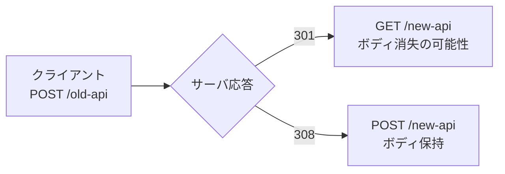

サイトのリニューアルやドメイン統一では、恒久リダイレクトの実装が避けられません。Rust の Web フレームワーク axum なら、数行で書けます。ただし、次の点でハマりやすい領域でもあります。

- 301 と 308 のどちらを返すべきか
- クエリ文字列やメソッドは保持されるのか
- ブラウザにキャッシュされた恒久リダイレクトは、誤っていても戻せない
- ホストやパスをそのまま Location に組み立てると、オープンリダイレクトになる

この記事では、axum 0.7 系で 308 Permanent Redirect を実装する 5 パターンを、テストとセキュリティ上の注意点まで含めて整理します。

:::message
対象読者は Rust と axum の基本 (Router / handler / extractor) を知っている中級者です。コードはすべて学習用の最小例で、ドメインには `example.com` を使っています。
:::

## TL;DR

- 恒久リダイレクトは、メソッドとボディを保持する **308** を第一候補にする。`Redirect::permanent` は 308 を返す
- 5 パターンを実装する: ①固定パス ②パラメータ付きパス ③www → apex 統一 ④末尾スラッシュ正規化 ⑤テスト
- Location を組み立てるときは、**先頭が `//` になるパス**と **Host ヘッダ依存**に注意する
- 本番投入の前に 307 (temporary) で動作確認する。308 はブラウザに強くキャッシュされる

## 1. 前提知識: 301 / 302 / 303 / 307 / 308 の違い

axum の `Redirect` が返すステータスコードは次のとおりです。

| コンストラクタ | ステータス | 意味 | メソッド保持 |
|---|---|---|---|
| `Redirect::permanent(uri)` | 308 | 恒久的に移動 | 保持される |
| `Redirect::temporary(uri)` | 307 | 一時的に移動 | 保持される |
| `Redirect::to(uri)` | 303 | See Other (GET で取り直す) | GET に変わる |

axum の `Redirect` には 301 / 302 を返す専用コンストラクタがありません。301 / 302 が必要なら、`StatusCode::MOVED_PERMANENTLY` と `LOCATION` ヘッダを自前で組み立てます。

301 と 308 の違いは、リダイレクト後のメソッドの扱いです。

- **301**: 歴史的な経緯で、クライアントが POST を GET に書き換えることを許容している
- **308**: 元のメソッドとボディを変えずに再送することを要求している

仕様は RFC 9110 (HTTP Semantics) の 15.4 節にあります。API エンドポイントのパス移行では、POST が GET に化けない 308 のほうが安全です。

SEO の観点では、Google Search Central の「Redirects and Google Search」に、301 と 308 はどちらも恒久的なリダイレクトのシグナルとして扱われると記載されています。308 を選んでも検索評価の引き継ぎで不利になる、という扱いではありません。



## 2. セットアップ

```toml
# Cargo.toml
[package]
name = "redirect-demo"
version = "0.1.0"
edition = "2021"

[dependencies]
axum = "0.7"
tokio = { version = "1", features = ["full"] }

[dev-dependencies]
tower = { version = "0.4", features = ["util"] }
```

axum / tokio / tower はいずれも MIT ライセンスです。

:::message alert
axum 0.8 ではパスパラメータの記法が `/:slug` から `/{slug}` に変わりました。この記事のコードは 0.7 系の記法 (`/:slug`) で書いています。0.8 を使う場合は読み替えてください。
:::

## 3. パターン①: 固定パスを 308 で移行する

最も単純なのは、旧パスと新パスが 1 対 1 のケースです。

```rust
use axum::{response::Redirect, routing::get, Router};

async fn old_blog_index() -> Redirect {
    Redirect::permanent("/articles")
}

fn app() -> Router {
    Router::new().route("/blog", get(old_blog_index))
}

#[tokio::main]
async fn main() {
    let listener = tokio::net::TcpListener::bind("127.0.0.1:3000")
        .await
        .unwrap();
    axum::serve(listener, app()).await.unwrap();
}
```

動作確認は curl で行います。

```bash
curl -i http://127.0.0.1:3000/blog
# HTTP/1.1 308 Permanent Redirect
# location: /articles
```

`get(...)` で登録すると GET 以外は 405 になります。旧 API を POST ごと移行したいなら、`axum::routing::any` や `post` も登録します。

```rust
use axum::routing::any;

Router::new().route("/api/v1/items", any(|| async {
    Redirect::permanent("/api/v2/items")
}))
```

## 4. パターン②: パスパラメータを引き継ぐ

`/blog/:slug` を `/articles/:slug` に移すケースです。

```rust
use axum::{extract::Path, response::Redirect, routing::get, Router};

async fn old_post(Path(slug): Path<String>) -> Redirect {
    Redirect::permanent(&format!("/articles/{slug}"))
}

fn app() -> Router {
    Router::new().route("/blog/:slug", get(old_post))
}
```

### クエリ文字列も保持する

上のコードでは `?utm_source=...` のようなクエリが落ちます。`RawQuery` で受け取って付け直します。

```rust
use axum::extract::RawQuery;

async fn old_post(
    Path(slug): Path<String>,
    RawQuery(query): RawQuery,
) -> Redirect {
    let target = match query {
        Some(q) => format!("/articles/{slug}?{q}"),
        None => format!("/articles/{slug}"),
    };
    Redirect::permanent(&target)
}
```

### 注意: 先頭を固定プレフィックスにする

`Path<String>` はパーセントデコード済みの値を返します。そのため、次のように **ユーザー入力だけで Location の先頭を作る**実装は危険です。

```rust
// NG 例: slug が "/evil.example" 系の値になりうる設計
Redirect::permanent(&format!("/{slug}"))
```

先頭が `//` になると、ブラウザはプロトコル相対 URL (`//evil.example`) と解釈します。**Location の先頭は必ず固定文字列** (`/articles/` など) にし、可変部分はその後ろに置いてください。

## 5. パターン③: www あり → なし (apex) に統一する

同じコンテンツを `www.example.com` と `example.com` の両方で配信していると、SEO 上は重複と見なされます。片方に統一するミドルウェアを書きます。

```rust
use axum::{
    extract::Request,
    http::header,
    middleware::{self, Next},
    response::{IntoResponse, Redirect, Response},
    routing::get,
    Router,
};

const CANONICAL_HOST: &str = "example.com";
const WWW_HOST: &str = "www.example.com";

async fn canonical_host(req: Request, next: Next) -> Response {
    let host = req
        .headers()
        .get(header::HOST)
        .and_then(|v| v.to_str().ok())
        .unwrap_or("");

    // ポート番号付き (例: www.example.com:443) を考慮して除去
    let host_no_port = host.split(':').next().unwrap_or("");

    if host_no_port.eq_ignore_ascii_case(WWW_HOST) {
        let path_and_query = req
            .uri()
            .path_and_query()
            .map(|pq| pq.as_str())
            .unwrap_or("/");
        let target = format!("https://{CANONICAL_HOST}{path_and_query}");
        return Redirect::permanent(&target).into_response();
    }

    next.run(req).await
}

fn app() -> Router {
    Router::new()
        .route("/", get(|| async { "ok" }))
        .layer(middleware::from_fn(canonical_host))
}
```

### Host ヘッダを信用しすぎない

「`www.` を剥がして Location を作る」という汎用実装は書きやすいのですが、攻撃者が任意の Host を送ってくる前提だと、**共有キャッシュに細工したリダイレクトが残る**リスクがあります。上のコードでは、**許可するホストを定数で固定**し、出力先も定数にしています。

### リバースプロキシ配下の場合

Traefik や Nginx の背後では、Host やスキームが書き換わることがあります。

- スキーム判定は `X-Forwarded-Proto`、ホスト判定は `X-Forwarded-Host` を見る
- ただし、これらのヘッダを信頼するのは「信頼できるプロキシ経由のときだけ」にする
- そもそも www 統一はプロキシ層 (Ingress など) で行うほうが単純な場合も多い

アプリ層に置くか、プロキシ層に置くかは構成次第です。アプリ単体で完結させたい、またはローカルでも同じ挙動を再現したい、という場合にはアプリ層が向いています。

## 6. パターン④: 末尾スラッシュを正規化する

`/articles/` と `/articles` が別 URL として扱われると、重複コンテンツになります。axum 0.7 は、末尾スラッシュ付きのパスを自動では正規化しません。

`tower-http` の `NormalizePathLayer` は、**内部で URI を書き換えて処理する**ものでリダイレクトしません。外部に見える URL を統一したいなら、自前で 308 を返すのが確実です。

```rust
use axum::{
    extract::Request,
    middleware::Next,
    response::{IntoResponse, Redirect, Response},
};

async fn strip_trailing_slash(req: Request, next: Next) -> Response {
    let path = req.uri().path();

    if path.len() > 1 && path.ends_with('/') {
        // 先頭・末尾のスラッシュを落としてから "/" を 1 個だけ付け直す
        let normalized = format!("/{}", path.trim_matches('/'));
        let target = match req.uri().query() {
            Some(q) => format!("{normalized}?{q}"),
            None => normalized,
        };
        return Redirect::permanent(&target).into_response();
    }

    next.run(req).await
}
```

### なぜ `trim_matches('/')` で整形するのか

素朴に `path.trim_end_matches('/')` だけで済ませると、`//example.org/` のようなパスから `//example.org` が生成されます。これはプロトコル相対 URL になり、**オープンリダイレクトの脆弱性**になります。先頭のスラッシュも含めて削り、`/` を 1 個だけ付け直せば、常に「同一オリジンの絶対パス」になります。

| リクエストパス | 素朴な実装の Location | 本実装の Location |
|---|---|---|
| `/articles/` | `/articles` | `/articles` |
| `/articles//` | `/articles` | `/articles` |
| `//example.org/` | `//example.org` (危険) | `/example.org` |
| `/` | (対象外) | (対象外) |

ミドルウェアは `Router::layer` で追加します。

```rust
let app = Router::new()
    .route("/articles", get(|| async { "list" }))
    .layer(middleware::from_fn(strip_trailing_slash));
```

axum 0.7 では、`Router::layer` で付けたミドルウェアはルートにマッチしなかったリクエスト (fallback) にも適用されます。ただし挙動はバージョンで変わりうるので、curl で `/unknown/` のようなパスを実際に叩いて確認してください。

## 7. パターン⑤: テストで 308 と Location を固定する

リダイレクトは、一度本番に出すと取り消しにくい変更です。`tower::ServiceExt::oneshot` を使えば、サーバを起動せずに Router を直接テストできます。

```rust
#[cfg(test)]
mod tests {
    use super::*;
    use axum::{
        body::Body,
        http::{header, Request, StatusCode},
    };
    use tower::ServiceExt;

    async fn get_response(uri: &str) -> axum::response::Response {
        app()
            .oneshot(Request::builder().uri(uri).body(Body::empty()).unwrap())
            .await
            .unwrap()
    
