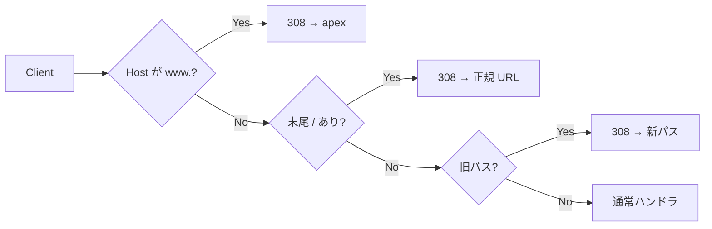

## TL;DR

- axum では `Redirect::permanent()` が **308 Permanent Redirect** を返す。`Redirect::temporary()` は 307、`Redirect::to()` は 303。
- 308 は 301 と違い **HTTP メソッドとボディを保持**する。POST の API 移行でも安全に使える。
- この記事では次の 5 パターンをコピペで動く形で紹介する。
  1. 固定パスの移転
  2. ワイルドカード配下の一括移転
  3. クエリ文字列の保持
  4. `www` → apex の正規化
  5. 末尾スラッシュの正規化
- 実装でハマりやすい 3 点も扱う。**panic**、**オープンリダイレクト**、**ブラウザの永続キャッシュ**。
- 検証環境は axum 0.7 系 / Rust stable。axum 0.8 ではパス構文が変わるので注意書きを入れた。

## 背景: なぜ 301 ではなく 308 なのか

サイトのリニューアルや API のバージョン移行で URL を変えるとき、恒久的なリダイレクトが必要になる。昔ながらの 301 には、**POST が GET に書き換えられてしまうクライアントが存在する**という歴史的な挙動差がある。

| ステータス | 意味 | メソッド保持 | キャッシュ |
|---|---|---|---|
| 301 Moved Permanently | 恒久移転 | 保証なし (GET 化される場合あり) | 永続 |
| 302 Found | 一時移転 | 保証なし | 原則しない |
| 303 See Other | 別 URL を GET で取得せよ | GET に変更 | しない |
| 307 Temporary Redirect | 一時移転 | **保持** | 原則しない |
| 308 Permanent Redirect | 恒久移転 | **保持** | 永続 |

308 は RFC 9110 §15.4.9 で定義されている。検索エンジン側の扱いについては、Google Search Central の「Redirects and Google Search」で、301 と 308 はどちらも恒久的なリダイレクトのシグナルとして扱われると説明されている。SEO 目的で 301 から 308 に切り替えても、シグナルとしては同等と考えてよい。

axum の対応は次のとおり。

| 関数 | ステータス |
|---|---|
| `Redirect::to(uri)` | 303 See Other |
| `Redirect::temporary(uri)` | 307 Temporary Redirect |
| `Redirect::permanent(uri)` | 308 Permanent Redirect |

## 準備

```toml
# Cargo.toml
[dependencies]
axum = "0.7"
tokio = { version = "1", features = ["full"] }

[dev-dependencies]
tower = { version = "0.5", features = ["util"] }
```

axum / tokio / tower はいずれも MIT ライセンスで公開されている。

> **axum 0.8 を使う場合の注意**
> パスパラメータの構文が `/:slug` から `/{slug}` に、ワイルドカードが `/*rest` から `/{*rest}` に変わった。以下のコードは 0.7 系の構文で書いている。

## パターン 1: 固定パスの移転

最もシンプルな形。

```rust
use axum::{response::Redirect, routing::get, Router};

fn app() -> Router {
    Router::new()
        .route("/about-us", get(|| async { Redirect::permanent("/about") }))
        .route("/about", get(|| async { "about page" }))
}

#[tokio::main]
async fn main() {
    let listener = tokio::net::TcpListener::bind("0.0.0.0:3000").await.unwrap();
    axum::serve(listener, app()).await.unwrap();
}
```

`curl -i localhost:3000/about-us` で次のように返る。

```http
HTTP/1.1 308 Permanent Redirect
location: /about
```

POST も保持したい場合は、`get` ではなく `any` や `post` でも登録する。

```rust
use axum::routing::any;

Router::new().route("/api/v1/items", any(|| async { Redirect::permanent("/api/v2/items") }))
```

クライアントが 308 を正しく扱うなら、POST ボディごと新 URL に再送される。ただし HTTP クライアントライブラリによっては、リダイレクト追従の設定が必要な場合がある。

## パターン 2: ワイルドカード配下の一括移転

`/blog/*` を `/articles/*` へ移す例。ここで **デコード済みの `Path<String>` を使わない**のがポイント (ハマりどころ ① で詳述)。

```rust
use axum::{extract::OriginalUri, response::Redirect, routing::get, Router};

async fn blog_to_articles(OriginalUri(uri): OriginalUri) -> Redirect {
    // 生のパス (パーセントエンコードされたまま) を使う
    let rest = uri.path().strip_prefix("/blog/").unwrap_or("");
    let query = uri.query().map(|q| format!("?{q}")).unwrap_or_default();
    Redirect::permanent(&format!("/articles/{rest}{query}"))
}

fn app() -> Router {
    Router::new().route("/blog/*rest", get(blog_to_articles))
}
```

`OriginalUri` は `nest` した場合でも、クライアントが送ってきた元の URI を取れる。パスとクエリの両方をそのまま引き継げるため、パターン 3 も同時に満たしている。

## パターン 3: クエリ文字列の保持

パターン 2 に含まれているが、独立したニーズも多いので単体でも示す。検索ページの URL 変更でよく使う。

```rust
async fn legacy_search(OriginalUri(uri): OriginalUri) -> Redirect {
    let query = uri.query().map(|q| format!("?{q}")).unwrap_or_default();
    Redirect::permanent(&format!("/search{query}"))
}
```

テストで挙動を固定しておく。`tower::ServiceExt::oneshot` を使えば、サーバーを起動せずに検証できる。

```rust
#[cfg(test)]
mod tests {
    use super::*;
    use axum::{body::Body, http::{header, Request, StatusCode}};
    use tower::ServiceExt;

    #[tokio::test]
    async fn keeps_query_string() {
        let app = Router::new().route("/old-search", get(legacy_search));
        let res = app
            .oneshot(
                Request::builder()
                    .uri("/old-search?q=rust&page=2")
                    .body(Body::empty())
                    .unwrap(),
            )
            .await
            .unwrap();

        assert_eq!(res.status(), StatusCode::PERMANENT_REDIRECT);
        assert_eq!(res.headers()[header::LOCATION], "/search?q=rust&page=2");
    }
}
```

## パターン 4: `www` → apex ドメインの正規化 (ミドルウェア)

`www.example.com` と `example.com` の両方が生きていると、評価が分散する。アプリ側で正規化する場合は `middleware::from_fn` が使いやすい。

```rust
use axum::{
    extract::Request,
    http::header,
    middleware::{self, Next},
    response::{IntoResponse, Redirect, Response},
};

async fn canonical_host(req: Request, next: Next) -> Response {
    let host = req
        .headers()
        .get(header::HOST)
        .and_then(|v| v.to_str().ok())
        .unwrap_or("");

    if let Some(bare) = host.strip_prefix("www.") {
        let pq = req
            .uri()
            .path_and_query()
            .map(|p| p.as_str())
            .unwrap_or("/");
        return Redirect::permanent(&format!("https://{bare}{pq}")).into_response();
    }
    next.run(req).await
}

fn app() -> Router {
    Router::new()
        .route("/", get(|| async { "ok" }))
        .layer(middleware::from_fn(canonical_host))
}
```

補足は次のとおり。

- ホスト名のリダイレクトは、**Ingress / リバースプロキシ / CDN** 側で行うほうが一般的で、アプリに負荷もかからない。アプリ側実装は、プロキシ設定を触れない環境や、ローカルでの挙動確認向けと考えるとよい。
- HTTP/2 では Host ヘッダーの代わりに `:authority` が使われる。環境によっては `req.uri().host()` も併用すると安全。
- http → https の強制は、TLS 終端がプロキシ側にあることが多い。そのため `X-Forwarded-Proto` を信頼してよいネットワーク構成かを確認してから実装する。

## パターン 5: 末尾スラッシュの正規化

`/about/` と `/about` が両方 200 を返すと、重複コンテンツになる。末尾スラッシュ付きを 308 で正規 URL に寄せる。

```rust
async fn strip_trailing_slash(req: Request, next: Next) -> Response {
    let path = req.uri().path();
    if path.len() > 1 && path.ends_with('/') {
        // 先頭の '/' を一旦全部落として 1 つだけ付け直す (ハマりどころ ② 参照)
        let trimmed = path.trim_matches('/');
        let query = req.uri().query().map(|q| format!("?{q}")).unwrap_or_default();
        return Redirect::permanent(&format!("/{trimmed}{query}")).into_response();
    }
    next.run(req).await
}
```

`tower-http` には `NormalizePathLayer` があるが、これは **リダイレクトではなく内部でパスを書き換える**ものである。URL を実際に正規化して検索エンジンに伝えたいなら、上のように 308 を返す実装が必要になる。なお `Router::layer` で付けたミドルウェアはルーティング後に走る点に注意。ルーティング前に適用したい場合は、`tower::Layer::layer` で `Router` 全体を包む。詳細は axum / tower-http のドキュメントを参照してほしい。

## 全体の流れ



リダイレクトの連鎖は 1 ホップに収めたい。`www` + 末尾スラッシュ + 旧パスが重なると 3 回跳ぶことになる。最終 URL を直接組み立てて 1 回で返すように設計すると、クローラにも優しい。

## ハマりどころ 3 選

### ① `Redirect::permanent` は不正な値で panic する

`Redirect::permanent` は、渡された文字列を `HeaderValue` に変換できないと **panic** する (ドキュメントにも記載がある)。`Path<String>` で取れる値は **パーセントデコード済み**なので、日本語や改行相当の文字が混ざった状態で埋め込むと危険になる。

```rust
// ❌ デコード済みの値をそのまま埋め込む
async fn bad(Path(slug): Path<String>) -> Redirect {
    Redirect::permanent(&format!("/articles/{slug}"))
}
```

対策はパターン 2 のとおり、`OriginalUri` から**エンコードされたままの生パス**を使うこと。値を加工する必要があるなら、`percent-encoding` クレートなどで明示的にエンコードし直す。

### ② オープンリダイレクト

リダイレクト先にユーザー入力を含める場合、`//evil.example/` のような **プロトコル相対 URL** がすり抜ける事故が起きる。末尾スラッシュの正規化で、単純に `path.trim_end_matches('/')` を使うと次のようになる。

- 入力: `//evil.example/`
- 出力: `Location: //evil.example` ← 外部サイトへ飛ぶ

パターン 5 で `trim_matches('/')` して `/` を 1 つだけ付け直しているのはこのため。原則として次の 2 つを守る。

- 外部から受け取った値を、**リダイレクト先のスキーム・ホスト部分に使わない**
- パスに使う場合も、**固定プレフィックスを必ず付ける**

### ③ 308 はブラウザに永続キャッシュされる

308 は恒久的なリダイレクトなので、ブラウザが長期間キャッシュする。**間違えて本番に出すと、ユーザー側のキャッシュが残って戻せなくなる**場合がある。

- 動作確認の段階では `Redirect::temporary` (307) で運用する
- 移行先が確定し、計測で問題がないと確認してから 308 に切り替える
- 切り替え後に戻すなら、`Cache-Control` を明示して寿命を制限する選択肢もある

検証は `curl -i` か、ブラウザのシークレットウィンドウで行うと、キャッシュの影響を受けにくい。

## まとめ

- axum の `Redirect::permanent` は 308 を返し、メソッドとボディを保持した恒久移転を表現できる。
- 実用上は、固定パス / ワイルドカード / クエリ保持 / ホスト正規化 / 末尾スラッシュの 5 パターンを押さえておけば、サイト移転のほとんどのケースをカバーできる。
- `oneshot` を使ったテストでステータスと `Location` を固定しておくと、移行作業が安全になる。
- panic・オープンリダイレクト・永続キャッシュの 3 点は、本番投入前に必ず確認する。

URL の正規化とリダイレクト設計は、従来の
