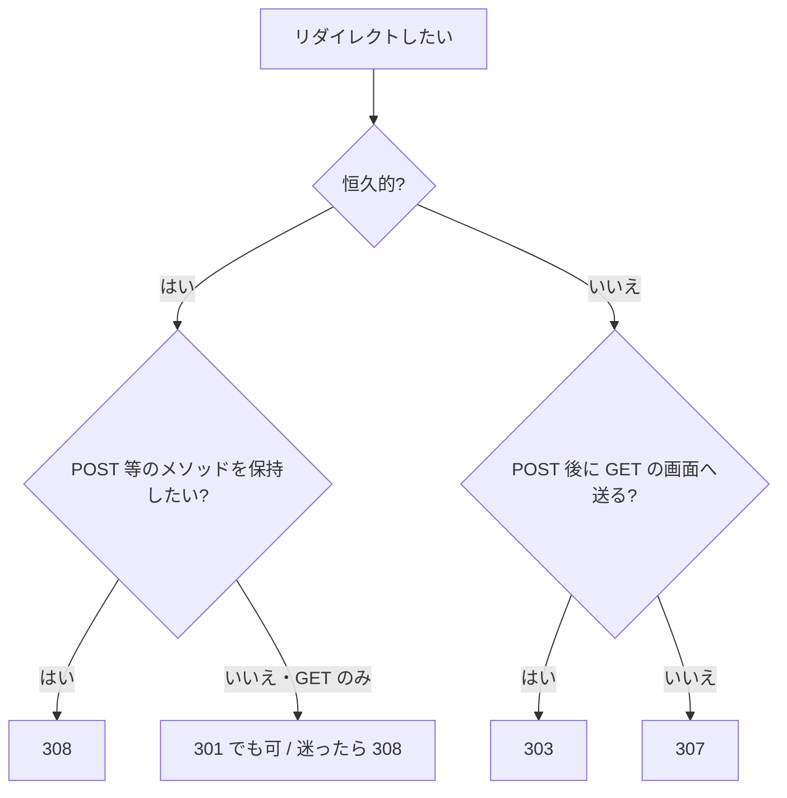

## この記事のゴール

リダイレクトは「`Location` を返すだけ」に見えますが、ステータスコードの選び方を間違えると次のような事故が起きます。

- POST が GET に化けてフォーム送信が消える
- 一時的なつもりの移転がブラウザに永続キャッシュされ、元に戻せない
- `?next=` パラメータ経由でオープンリダイレクト脆弱性になる

この記事では Rust の axum (0.8 系) で、実務で出番の多い 5 パターンを実装しながら、ステータスコード選定の理由と落とし穴を整理します。

対象読者は Rust の基本文法と axum の `Router` / ハンドラを一度でも書いたことがある中級者です。

## ステータスコードの違いを 1 枚で整理

リダイレクト系ステータスは、次の 2 軸で理解するとブレません。

1. **メソッドとボディを保持するか** (POST のまま再送されるか)
2. **永続か一時か** (デフォルトでキャッシュ可能か)

| コード | 名称 | 種別 | メソッド保持 | 主な用途 |
|---|---|---|---|---|
| 301 | Moved Permanently | 永続 | 不定 (歴史的に POST→GET 変換あり) | 旧来の恒久移転 |
| 302 | Found | 一時 | 不定 (同上) | 旧来の一時移転 |
| 303 | See Other | 一時 | 常に GET へ変更 | POST 後の画面遷移 (PRG) |
| 307 | Temporary Redirect | 一時 | **保持** | メソッドを守る一時移転 |
| 308 | Permanent Redirect | 永続 | **保持** | メソッドを守る恒久移転 |

301/302 は仕様策定当時、実装の多くが POST を GET に変えて追従していました。その後 RFC 上は「クライアントがメソッドを変更してもよい (MAY)」という扱いになっています。

この曖昧さを解消するために作られたのが 307/308 です。メソッドが変わらないことが保証されるので、API の恒久移転では **308** が第一候補になります。

また 301/308 は、明示的なキャッシュ指示がなくても **ヒューリスティックにキャッシュ可能** と定義されています (RFC 9110)。この点は後述の落とし穴 1 に関わります。



## axum の Redirect 型とステータスの対応

axum には `axum::response::Redirect` があり、コンストラクタごとにステータスが決まっています。

| コンストラクタ | ステータス |
|---|---|
| `Redirect::to(uri)` | 303 See Other |
| `Redirect::temporary(uri)` | 307 Temporary Redirect |
| `Redirect::permanent(uri)` | 308 Permanent Redirect |

注意点は、**`Redirect::to` が 302 ではなく 303** であることです。他のフレームワークの感覚で `to` を使うと、POST が GET に変わります。

301/302 が必要な場面 (古いクローラや外部連携の都合など) では、次のように手組みします。

```rust
use axum::{
    http::{header, StatusCode},
    response::IntoResponse,
};

async fn legacy_301() -> impl IntoResponse {
    (StatusCode::MOVED_PERMANENTLY, [(header::LOCATION, "/new")])
}
```

## セットアップ

```toml
# Cargo.toml
[dependencies]
axum = "0.8"
tokio = { version = "1", features = ["full"] }

[dev-dependencies]
tower = { version = "0.5", features = ["util"] }
```

ライセンスはいずれも MIT です (axum / tokio / tower)。

## パターン 1: 固定パスの恒久移転 (308)

最小構成です。API のパスを変更し、旧パスからメソッドを保ったまま新パスへ誘導します。

```rust
use axum::{response::Redirect, routing::any, Router};

#[tokio::main]
async fn main() {
    let app = Router::new()
        .route("/api/v2/users", any(|| async { "users v2" }))
        // 旧パスは 308 で恒久移転 (POST もそのまま再送される)
        .route(
            "/api/users",
            any(|| async { Redirect::permanent("/api/v2/users") }),
        );

    let listener = tokio::net::TcpListener::bind("127.0.0.1:3000")
        .await
        .unwrap();
    axum::serve(listener, app).await.unwrap();
}
```

`curl` で確認します。

```bash
curl -i -X POST http://127.0.0.1:3000/api/users
# HTTP/1.1 308 Permanent Redirect
# location: /api/v2/users
```

## パターン 2: パスパラメータを引き継ぐ移転

ブログの URL 構造変更のように、`/posts/{id}` を `/articles/{id}` へ移す例です。axum 0.8 のパス記法は `{id}` です (0.7 以前は `:id`)。

```rust
use axum::{extract::Path, response::Redirect, routing::get, Router};

async fn old_post(Path(id): Path<String>) -> Redirect {
    // id は URL エンコードの解釈後の値。再度パスに埋めるので、英数字とハイフンのみ許可する
    if id.chars().all(|c| c.is_ascii_alphanumeric() || c == '-') {
        Redirect::permanent(&format!("/articles/{id}"))
    } else {
        Redirect::temporary("/articles")
    }
}

fn app() -> Router {
    Router::new()
        .route("/posts/{id}", get(old_post))
        .route("/articles/{id}", get(|| async { "article" }))
        .route("/articles", get(|| async { "list" }))
}
```

デコード済みの値をそのまま `Location` に連結すると、改行や `/` を含む値でヘッダ・パスの注入が起こり得ます。ホワイトリストで検証してから埋め込むのが安全です。

## パターン 3: POST 後の画面遷移 (303 / PRG パターン)

フォーム送信後にリロードしても二重送信されないよう、**Post/Redirect/Get** を使います。ここは 303 の出番で、`Redirect::to` がそのまま使えます。

```rust
use axum::{extract::Form, response::Redirect, routing::post, Router};
use serde::Deserialize; // serde = { version = "1", features = ["derive"] }

#[derive(Deserialize)]
struct Contact {
    message: String,
}

async fn submit(Form(_c): Form<Contact>) -> Redirect {
    // ここで保存処理 …
    Redirect::to("/contact/thanks") // 303: 必ず GET で追従される
}

fn app() -> Router {
    Router::new().route("/contact", post(submit))
}
```

307 を使うと POST がそのまま `/contact/thanks` に再送されて 405 になりがちです。「POST の結果画面へ送る」用途は 303 と覚えておくと確実です。

## パターン 4: ホスト正規化 (www → apex)

SEO では、同一コンテンツが複数ホストで見えると評価が分散します。`www.example.com` を `example.com` に寄せるミドルウェアの例です。

```rust
use axum::{
    extract::Request,
    http::{header, StatusCode},
    middleware::{self, Next},
    response::{IntoResponse, Response},
    routing::get,
    Router,
};

async fn canonical_host(req: Request, next: Next) -> Response {
    let host = req
        .headers()
        .get(header::HOST)
        .and_then(|v| v.to_str().ok())
        .unwrap_or("");

    if let Some(bare) = host.strip_prefix("www.") {
        let pq = req
            .uri()
            .path_and_query()
            .map(|p| p.as_str())
            .unwrap_or("/");
        let location = format!("https://{bare}{pq}");
        return (StatusCode::PERMANENT_REDIRECT, [(header::LOCATION, location)])
            .into_response();
    }
    next.run(req).await
}

fn app() -> Router {
    Router::new()
        .route("/", get(|| async { "ok" }))
        .layer(middleware::from_fn(canonical_host))
}
```

リバースプロキシ (Traefik や nginx など) の背後で動かす場合は、`Host` の代わりに `X-Forwarded-Host` を信頼する構成も多くあります。ただし、そのヘッダを無条件に信頼すると偽装されます。**信頼できるプロキシからのものだけ** を採用する前提で設計してください。そもそもプロキシ層でリダイレクトするほうが単純な場合も多いです。

## パターン 5: 末尾スラッシュ正規化

`/about/` と `/about` が別 URL として扱われる問題です。axum の `Router` は両者を別ルートとして扱うため、片方に統一します。

`tower-http` の `NormalizePath` は **リライト** であり、リダイレクトではありません。クライアントの URL バーは変わらず、重複 URL 問題は解決しません。リダイレクトにしたい場合は、fallback で処理するのが簡単です。

```rust
use axum::{
    http::{StatusCode, Uri},
    response::{IntoResponse, Redirect, Response},
    routing::get,
    Router,
};

async fn fallback(uri: Uri) -> Response {
    let path = uri.path();
    if path.len() > 1 && path.ends_with('/') {
        let trimmed = path.trim_end_matches('/');
        let target = match uri.query() {
            Some(q) => format!("{trimmed}?{q}"),
            None => trimmed.to_string(),
        };
        return Redirect::permanent(&target).into_response();
    }
    StatusCode::NOT_FOUND.into_response()
}

fn app() -> Router {
    Router::new()
        .route("/about", get(|| async { "about" }))
        .fallback(fallback)
}
```

`/about/` はどのルートにも一致せず fallback に入るため、`/about` へ 308 で誘導されます。クエリ文字列を落とさないことがポイントです。

`trim_end_matches('/')` の結果が空になるのは `//` のようなパスです。この例では `path.len() > 1` かつ先頭が `/` の場合に限られるため、`//` は `""` になり得ます。本番では空文字のときに `/` へフォールバックする分岐を入れてください。

## 落とし穴 4 選

### 落とし穴 1: 301/308 はブラウザに永続キャッシュされる

恒久リダイレクトは、一度返すとブラウザが `Location` を覚えます。**サーバ側で設定を戻してもクライアントが追従し続ける** ため、誤設定の取り消しが困難です。

対策は次のとおりです。

- 開発中・検証中は **307 / 302** で動作確認し、確定してから 308 に切り替える
- 一時移転の `Cache-Control` を明示する場合は `no-store` や `max-age` を意識的に付ける
- ブラウザでの確認時は開発者ツールの「キャッシュを無効化」か、シークレットウィンドウを使う

### 落とし穴 2: オープンリダイレクト

ログイン後の戻り先を `?next=` で受ける実装は定番ですが、検証なしで `Location` に入れると、外部サイトへの誘導に悪用されます。

```rust
/// 同一オリジン内の相対パスだけを許可する
fn safe_next(next: &str) -> &str {
    let ok = next.starts_with('/')
        && !next.starts_with("//")   // プロトコル相対 URL を拒否
        && !next.starts_with("/\\")  // バックスラッシュ経由のバイパスを拒否
        && !next.contains('\r')
        && !next.contains('\n');
    if ok { next } else { "/" }
}
```

絶対 URL を許可したい場合は、許可ホストのホワイトリストで厳密に照合します。`starts_with("https://example.com")` のような前方一致は `https://example.com.evil.test` を通してしまうので避けてください。URL をパースしてホスト部を完全一致で比較します。

### 落とし穴 3: リダイレクトチェーンとループ

`http→https`、`www→apex`、末尾スラッシュ正規化を別々の層で実装すると、1 リクエストで 3 回リダイレクトされることがあります。クローラの巡回効率や初回表示速度に響きます。

対策は次のとおりです。

- 正規化は **1 回のリダイレクトで最終 URL に到達** するようにまとめる (ホスト・スキーム・スラッシュを一括で計算)
- `curl -IL` でホップ数を確認する習慣をつける

```bash
curl -sIL -o /dev/null -w "%{num_redirects} hops, final: %{url_effective}\n" \
  http://www.example.com/about/
```

ループ (A→B→A) は、正規化ロジックが冪等でないときに起きます。「正規化関数を 2 回適用しても結果が同じ」ことをユニットテストで保証すると安心です。

### 落とし穴 4: フラグメント (`#...`) はサーバに届かない

URL の `#` 以降はブラウザ内で処理され、HTTP リクエストには含まれません。そのため `Location` に引き継げるのは通常ブラウザ側の仕事です。`Location` にフラグメントが含まれない場合、元 URL のフラグメントは維持されるのが一般的な挙動です。サーバ側でフラグメントを制御しようとする設計は避けてください。

## テストを書く

リダイレクトは回帰が起きやすいので、`tower::ServiceExt::oneshot` で HTTP を立てずにテストします。

```rust
#[cfg(test)]
mod tests {
    use super::*;
    use axum::{
        body::Body,
        http::{header, Request, StatusCode},
    };
    use tower::ServiceExt; // oneshot

    async fn get(app: axum::Router, uri: &str) -> axum::response::Response {
        app.oneshot(Request::builder().uri(uri).body(Body::empty()).unwrap())
            .await
            .unwrap()
    }

    #[tokio::test]
    async fn trailing_slash_redirects_with_query() {
        let res = get(app(), "/about/?lang=ja").await;
        assert_eq!(res.status(), StatusCode::PERMANENT_REDIRECT);
        assert_eq!(res.headers()[header::LOCATION], "/about?lang=ja");
    }

    #[tokio::test]
    async fn no_redirect_for_normal_path() {
        let res = get(app(), "/about").await;
        assert_eq!(res.status(), StatusCode::OK);
    }
}
```

テストでは `Location` の値まで検証します。ステータスだけ見ていると、クエリ欠落のようなバグを見逃します。

## まとめ

- ステータスは「**メソッド保持**」と「**永続/一時**」の 2 軸で選ぶ。迷ったら恒久は 308、一時は 307、POST 後の遷移は 303
- axum の `Redirect::to` は **303**。他フレームワークの 302 感覚で使うと POST が GET になる
- 301/308 は永続キャッシュされるため、**確定するまでは 307** で検証する
- `?next=` 系は必ず相対パスのホワイトリスト検証を入れ、オープンリダイレクトを防ぐ
- 正規化 (ホスト・スキーム・スラッシュ) は 1 ホップにまとめ、`oneshot` でテストを固定する

URL 正規化は、検索エンジンからの評価を一本化するうえでも地味に効く領域です。AI 検索時代にも同様に「正規 URL を 1 つに定める」基本は重要です。実装レベルで一度見直す価値があります。

## 参考リンク

- RFC 9110 HTTP Semantics, Section 15.4 Redirection 3xx: https://www.rfc-editor.org/rfc/rfc9110#name-redirection-3xx
- MDN Web Docs: HTTP リダイレクト: https://developer.mozilla.org/ja/docs/Web/HTTP/Redirections
- axum 公式ドキュメント (`axum::response::Redirect`): https://docs.rs/axum/latest/axum/response/struct.Redirect.html
- tower-http (`NormalizePath`): https://docs.rs/tower-http/latest/tower_http/normalize_path/
- OWASP: Unvalidated Redirects and Forwards Cheat Sheet: https://cheatsheetseries.owasp.org/cheatsheets/Unvalidated_Redirects_and_Forwards_Cheat_Sheet.html

使用した OSS のライセンス: axum (MIT) / tokio (MIT) / tower (MIT) / serde (MIT OR Apache-2.0)

---

✍️ 本記事の著者: **合同会社ジモラボ**

ジモラボは、八王子を拠点に AI を活用した SaaS を多数開発しています。

- 🌐 公式サイト: https://locallab.jp
- 🔍 AI SEO 最適化 SaaS: [lookupai.jp](https://lookupai.jp)
- 📺 YouTube: [@locallab_llc](https://www.youtube.com/@locallab_llc)
- ✉️ お問い合わせ: info@locallab.jp
